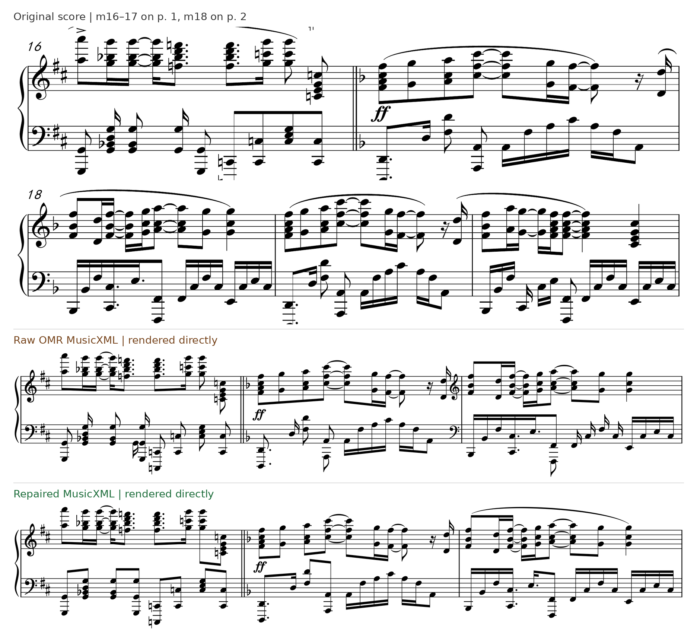
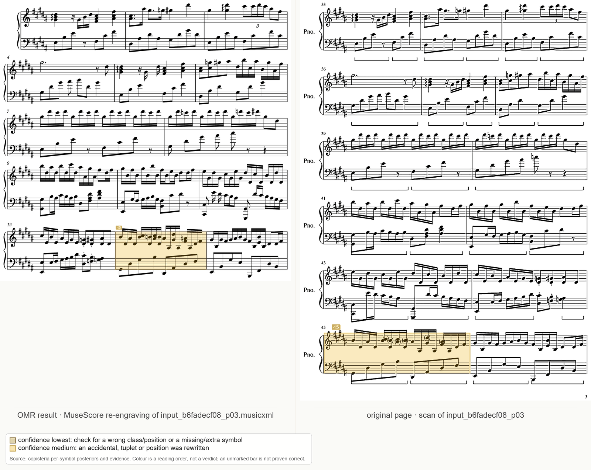

<div align="right">

**中文** · [English](README_EN.md)

</div>

# copisteria-score-to-mscz

**把印刷五线谱 PDF 转成可编辑的 MusicXML 和 MuseScore 乐谱，并生成逐小节核对材料。**

识别、修复和渲染都在本地完成。项目的目标是交付一份**可靠、可追溯、能继续编辑的初稿**，而不是承诺“一键完美识谱”。

## 识别核心：[copisteria](https://github.com/kobimusic/copisteria)

本项目从 **[copisteria](https://github.com/kobimusic/copisteria)**（KobiMusic，Apache-2.0）的逐页识别结果开始。copisteria 面向真实扫描谱，将页面图像转成 MusicXML：符号检测器识别 270 类记号，evidence transformer 再结合整页上下文判断音高、声部、onset、节奏、调号和拍号。除 MusicXML 外，它还输出每个符号的阅读证据和可检查的 HTML 页面。

上游的 [OMR-NED benchmark](https://github.com/kobimusic/copisteria#benchmark) 报告了以下真实扫描集结果；数字是**错误率，越低越好**：

| 系统 | 弦乐四重奏（252 页） | 艺术歌曲（55 页） | 钢琴谱（112 页） |
|---|---:|---:|---:|
| **copista-28m** | **8.6%** | **16.9%** | **31.5%** |
| copista-2m | 11.1% | 17.0% | 34.3% |
| Audiveris 5.11 | 66.9% | 51.8% | 62.6% |

上游还报告 copista-28m 在五个数据集合计 735 页上的错误率为 11.3%。这些数字描述的是 **copisteria 本身及上游评测口径**，不是本项目修复后的准确率。

本项目的职责是承接这些逐页草稿：合并整谱、修复结构、生成 `.mscz`，并提供逐小节核对材料。如果只需要原始 OMR 或要研究识别模型，可以直接使用 copisteria。

## 先看效果：OMR 草稿之后发生了什么

下面是《Sincerely》m16–18，依次放入原谱、OMR 原始 MusicXML 和修复后 MusicXML。两份 XML 都由 MuseScore 直接渲染；原谱在此处跨页，因此第一组包含两条谱表。



这个片段主要展示**连梁分组和局部排版的整理**，例如 m16/m18 低音按拍重排连梁分组，清理 m17 末的冗余跨页谱号，并恢复 m18 的圆滑线。它不是识别准确率的证明；原谱与结果之间的音高、声部等差异仍需人工核对。小节时值、连线和 MuseScore 导入后的结构由报告与 review 工具另行检查。

它**不会凭猜测改音高**。标题、速度和谱面补充信息通过带证据的 facts 或受限 patch 注入。

## 对照原谱，而不是盲信识别结果

交付时会生成 `review-sheets.pdf`：左侧是最终交付乐谱（优先使用 `score.mscz`，无 `.mscz` 时退回修复后的 `score.musicxml`）按原扫描页分页渲染的结果，右侧是原始扫描；同一小节使用相同编号和颜色，优先标出值得人工检查的位置。



- 红色、黄色表示不同的核对优先级，不代表系统已经判定错误。
- `≠` 表示小节时值不符；未着色也不等于已经证明正确。
- `review/confidence/` 另提供符号级热图，用来定位具体音符或记号。

## 你会得到什么

| 文件 | 用途 |
|---|---|
| `score.mscz` | 在 MuseScore 中播放、编辑、重新排版或导出 MIDI |
| `score.musicxml` | 合并、修复后的语义主文件，可导入其他制谱软件 |
| `score.pdf` | 交付乐谱的渲染件 |
| `review-sheets.pdf` | 全部页面的小节对照图，**人工核对从这里开始** |
| `report.json` / `review-report.json` | 修复轨迹、校验结果、页覆盖和阻断项 |
| `work/copisteria/` | 逐页 OMR 原始输出，保留用于追溯 |

完整交付还保留 `mechanical/` 基线和必要的 `forced-truncation/` 可编辑副本，便于比较改动。截断副本不是语义主文件；具体分工见 [`references/delivery.md`](references/delivery.md)。

## 工作流程

```text
PDF
  → copisteria 逐页识别
  → 逐页 MusicXML + 符号置信度
  → scorepipe 合并、声部/时值/连线修复
  → facts 与受限 patch（可选、可追溯）
  → MusicXML 主文件
  → MuseScore：.mscz + score.pdf
  → 只读校验 + review-sheets.pdf
```

保留“逐页”这一层很重要：跨页延音线、圆滑线和其他连续记号需要页边界上下文才能恢复。修复阶段会重复运行到稳定，再由独立校验器检查结果；命令成功退出并不等于可以跳过渲染核对。

## 快速开始

### 1. 准备依赖

- **Python 3.10+**：运行本项目。
- **[copisteria](https://github.com/kobimusic/copisteria) 与模型权重**：负责 OMR；按上游文档准备独立 Python 环境。
- **MuseScore 4**：生成 `.mscz` 并渲染 PDF。
- **poppler**：提供 `pdfinfo`、`pdftoppm` 和 `pdfimages`，用于 PDF 页数与页面图像提取。

`preflight.py` 只检查环境，不会下载模型、安装系统软件或修改原始 PDF。

### 2. 安装并检查

```bash
git clone https://github.com/Chitius/copisteria-score-to-mscz.git
cd copisteria-score-to-mscz
python -m pip install -e .

# 如果 copisteria 装在独立虚拟环境里，首次探测直接指明解释器和源码目录：
python scripts/preflight.py \
  --omr-python "path/to/.venv-copisteria/Scripts/python.exe" \
  --repo "path/to/copisteria" \
  --save env.local.json
```

`env.local.json` 只保存本机工具路径，已被 Git 忽略，不要提交；后续运行 `convert.py` / `review.py` 会自动读取它。路径配置详见 [`references/environment.md`](references/environment.md)。

### 3. 从 PDF 生成初稿

```bash
python scripts/convert.py "score.pdf" --outdir "out/score" \
  --title "标题" --composer "作曲"
```

这一步完成逐页 OMR、合并修复和渲染。有 NVIDIA GPU 可加 `--device cuda` 提速，低配环境可用 `--detector 2m`，局部试跑可加 `--range 1-2`。生成的 `out/score/score.mscz` 可以立即打开，但仍是待复核初稿。

### 4. 生成核对材料与交付目录

如果还没有逐页 facts，先生成机械基线：

```bash
python scripts/review.py "score.pdf" --pages "out/score/work/copisteria" \
  --skip-facts --title "标题" --composer "作曲" --outdir "review/score"
```

打开 `review/score/review-sheets.pdf` 核对。`--skip-facts` 表示没有注入标题、速度等逐页事实，因此不能把这一版描述为“已完成完整人工复核”。

准备好 facts 后，运行正式 review：

```bash
python scripts/review.py "score.pdf" --pages "out/score/work/copisteria" \
  --facts-dir "review/facts" --outdir "review/score"
```

只需要 MusicXML 时，也可以跳过 OMR 调用和 review，直接处理已有逐页目录：

```bash
python -m scorepipe.cli "out/score/work/copisteria" -o "out/score/score.musicxml"
```

## facts、patch 与 AI 助手

- **facts**：注入标题、作曲、速度、排练号以及多声部乐器元数据（`parts`：声部名、简称、乐器预设或 GM 音色）等明确事实；每项都应带页码和证据。准备与校验流程见 [`references/facts.md`](references/facts.md)。
- **notation patch**：用音符锚点补入证据充分的 `ottava`（8va/8vb，含单和弦同拍）、`tuplet`、`clef`、`pedal`、`wedge`（hairpin）、`dynamic`、`repeat`、`volta`、`fermata`、`navigation`（`segno`/`coda`）、`ornament`（颤音/波音/回音/单音震音）、`glissando`、`arpeggio`（含跨谱表琶音）与 `parentheses`（括号音符/变音记号）修正（支持按 `part` 定位），也支持对人工接受的音高/八度/时值 `corrections` 做受控应用；范围不确定时保留为未决，不自动扩张。见 [`references/notation-patches.md`](references/notation-patches.md)。
- **AI 助手**：本仓库同时提供 [`SKILL.md`](SKILL.md)，约束助手完成环境检查、逐页 OMR、证据收集、复核和交付。助手可以提出修正，但不能自行把提案当作已接受结果。

## 适用范围与限制

- 面向**印刷五线谱**，稳定主力场景为**单 `<part>` 乐谱**（双谱表钢琴谱与单行旋律）。
- **多 `<part>` 乐谱（实验性）**：已实验性支持声乐 + 钢琴艺术歌曲、小型室内乐与乐队总谱的整谱合并、逐声部修复/截断、单谱表架子鼓 GM 鼓键与镲片 `x` 符头自动映射，以及通过 `facts.json` 注入各声部乐器音色；但跨页声部对齐、复杂打击乐连音与中文乐器标签等场景仍处于实验阶段，需结合 `review-sheets.pdf` 人工复核。手写谱、简谱、六线谱不属于已验证场景。
- OMR 仍可能产生八度、加线、声部、休止符和密集和弦错误。结构校验通过不代表音高正确，**人工核对不可省略**。
- OMR 仍可能漏掉踏板、hairpin、反复跳房子、延长记号、装饰音/震音、跨谱表琶音或可选音符括号等记号；上述记号均可通过受限 notation patch 补入，其余未覆盖记号应明确记录，不靠猜测补齐。
- 8va/8vb 需要证据充分且经接受的 patch；无法确定覆盖范围时保持未决。
- PDF 文字层可能错位或乱码，标题、作曲和速度应以页面证据为准。
- 一次处理一份乐谱；没有内建批处理。扫描倾斜、透视或分辨率过低会显著影响识别质量。

## 开发与文档

- [`SKILL.md`](SKILL.md)：agent/运维操作契约。
- [`docs/DEVELOPMENT.md`](docs/DEVELOPMENT.md) 与 [`docs/DESIGN.md`](docs/DESIGN.md)：架构和开发说明。
- [`references/`](references/)：环境、OMR、facts、复核与交付的详细参考。
- 运行测试：`python -m pytest tests -q`。
- 报告问题时，请附上页码/小节号、对应对照页，以及该页的 OMR `reading.json`；不要附带 `env.local.json` 等本机配置。

## 许可证与致谢

本项目使用 [MIT 许可证](LICENSE)。

OMR 由 **[copisteria](https://github.com/kobimusic/copisteria)**（KobiMusic，Apache-2.0）完成；本项目负责其后的合并、结构修复、渲染与复核。感谢上游作者开放这项工作，署名见 [`NOTICE`](NOTICE)。`.mscz` 与 PDF 的生成使用 MuseScore 4，PDF 页面处理使用 poppler。
