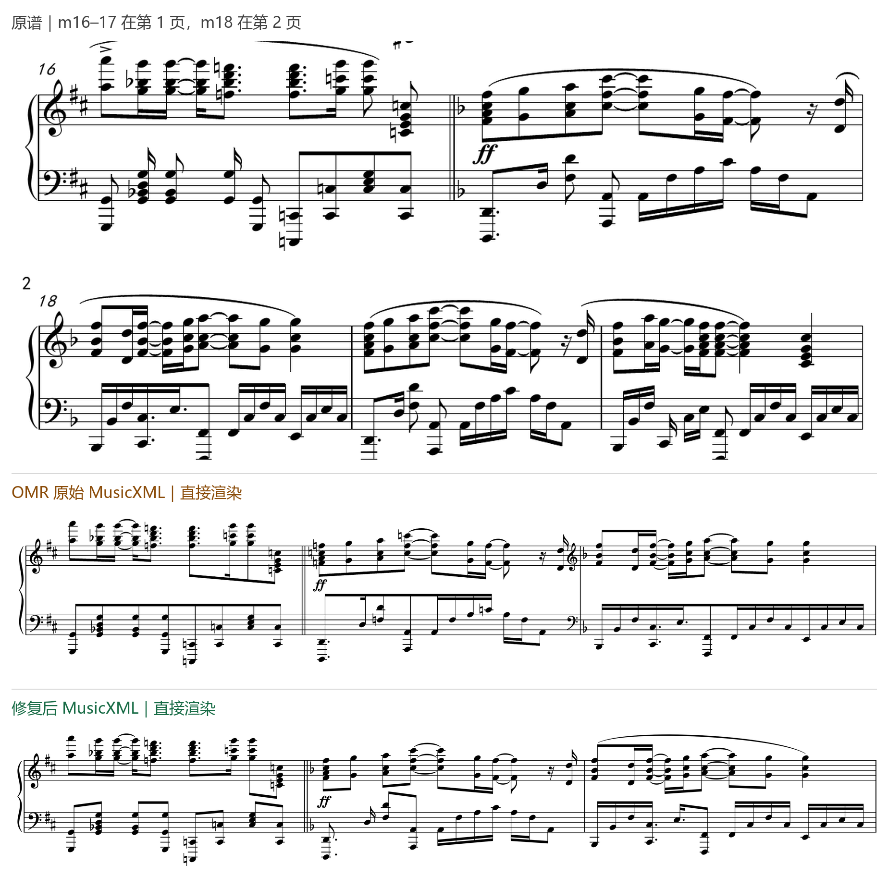
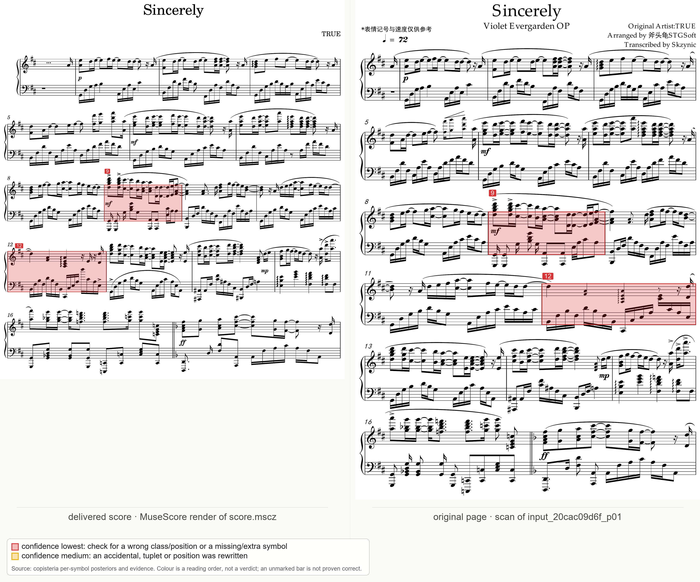

<div align="right">

[中文](README.md) · **English**

</div>

# copisteria-score-to-mscz

**Convert printed staff-notation PDFs into editable MusicXML and MuseScore scores, with measure-by-measure review materials.**

Recognition, repair, and rendering all run locally. The project's goal is to deliver a **reliable, traceable, and editable first draft** — not to promise "one-click perfect transcription."

## Recognition core: [copisteria](https://github.com/kobimusic/copisteria)

This project starts from the per-page recognition output of **[copisteria](https://github.com/kobimusic/copisteria)** (KobiMusic, Apache-2.0). Built for real-world scanned scores, copisteria turns page images into MusicXML: a symbol detector recognizes 270 classes of notation, and an evidence transformer then reasons over whole-page context to determine pitch, voice, onsets, rhythm, key signatures, and time signatures. Beyond MusicXML, it also emits per-symbol reading evidence and inspectable HTML pages.

The upstream [OMR-NED benchmark](https://github.com/kobimusic/copisteria#benchmark) reports the following results on real scanned sets; the numbers are **error rates — lower is better**:

| System | String quartet (252 pages) | Art song (55 pages) | Piano score (112 pages) |
|---|---:|---:|---:|
| **copista-28m** | **8.6%** | **16.9%** | **31.5%** |
| copista-2m | 11.1% | 17.0% | 34.3% |
| Audiveris 5.11 | 66.9% | 51.8% | 62.6% |

Upstream also reports a 11.3% error rate for copista-28m across 735 pages pooled from five datasets. These numbers describe **copisteria itself and the upstream evaluation protocol**, not the accuracy of this project after repair.

This project's job is to take over those per-page drafts: merge them into a full score, repair the structure, generate the `.mscz`, and produce measure-by-measure review materials. If you only need raw OMR output or want to study the recognition model, use copisteria directly.

## See the effect first: what happens after the OMR draft

Below is *Sincerely* m16–18, showing the original score, the raw OMR MusicXML, and the repaired MusicXML side by side. Both XML files are rendered directly by MuseScore; the original happens to span a page turn here, so the first group includes two systems.



This excerpt mainly demonstrates **beam-grouping and local layout cleanup** — for example, the left hand in m16 changes from a single beam spanning the whole bar to beams grouped by beat. It is not proof of recognition accuracy; pitch, voice, and other differences between the original and the result still require human verification. Measure durations, ties, and the structure after MuseScore import are checked separately by the reports and review tools.

It **never changes pitches by guesswork**. Titles, tempo marks, and supplementary score information are injected through evidence-backed facts or restricted patches.

## Compare against the original — don't blindly trust the recognition

Delivery includes a `review-sheets.pdf`: the delivered score rendering on the left (using `score.mscz` when available, or the repaired `score.musicxml`, paginated to match the scan pages) and the original scan on the right; matching measures share the same number and color, with locations worth checking flagged first.



- Red and yellow indicate different review priorities — they do not mean the system has judged something wrong.
- `≠` marks a measure-duration mismatch; an uncolored measure is not proof of correctness either.
- `review/confidence/` provides symbol-level heatmaps to pinpoint specific notes or marks.

## What you get

| File | Purpose |
|---|---|
| `score.mscz` | Play, edit, re-layout, or export MIDI in MuseScore |
| `score.musicxml` | The merged, repaired semantic master file; importable into other notation software |
| `score.pdf` | Rendered copy of the delivered score |
| `review-sheets.pdf` | Measure-by-measure comparison for every page — **start your human review here** |
| `report.json` / `review-report.json` | Repair traces, validation results, page coverage, and blocking items |
| `work/copisteria/` | Raw per-page OMR output, kept for traceability |

A full delivery also keeps the `mechanical/` baseline and, when needed, an editable `forced-truncation/` copy for comparison. The truncated copy is not the semantic master; see [`references/delivery.md`](references/delivery.md) for how the pieces fit together.

## Workflow

```text
PDF
  → per-page recognition by copisteria
  → per-page MusicXML + symbol confidence
  → scorepipe merge, voice/duration/tie repair
  → facts and restricted patches (optional, traceable)
  → MusicXML master file
  → MuseScore: .mscz + score.pdf
  → read-only validation + review-sheets.pdf
```

Keeping the "per-page" layer matters: cross-page ties, slurs, and other continuous marks need page-boundary context to be recovered. The repair stage runs repeatedly until stable, and an independent validator checks the result; a successful exit code does not mean you can skip the rendered review.

## Quick start

### 1. Prepare dependencies

- **Python 3.10+**: runs this project.
- **[copisteria](https://github.com/kobimusic/copisteria) and its model weights**: handles the OMR; set up its own Python environment per the upstream docs.
- **MuseScore 4**: generates the `.mscz` and renders the PDF.
- **poppler**: provides `pdfinfo`, `pdftoppm`, and `pdfimages` for page counts and page image extraction.

`preflight.py` only checks the environment — it downloads no models, installs no system software, and does not modify your original PDF.

### 2. Install and check

```bash
git clone https://github.com/Chitius/copisteria-score-to-mscz.git
cd copisteria-score-to-mscz
python -m pip install -e .

# When copisteria lives in its own venv, pass its interpreter and checkout once:
python scripts/preflight.py \
  --omr-python "path/to/.venv-copisteria/Scripts/python.exe" \
  --repo "path/to/copisteria" \
  --save env.local.json
```

`env.local.json` stores only local tool paths, is ignored by Git, and must not be committed; subsequent `convert.py` and `review.py` runs pick it up automatically. See [`references/environment.md`](references/environment.md) for path configuration.

### 3. Generate a first draft from a PDF

```bash
python scripts/convert.py "score.pdf" --outdir "out/score" \
  --title "Title" --composer "Composer"
```

This runs per-page OMR, merge/repair, and rendering. Pass `--device cuda` if you have an NVIDIA GPU, `--detector 2m` for the lighter detector, or `--range 1-2` to test a few pages first. The resulting `out/score/score.mscz` can be opened right away, but it is still a draft pending review.

### 4. Generate review materials and the delivery directory

If you don't have per-page facts yet, generate the mechanical baseline first:

```bash
python scripts/review.py "score.pdf" --pages "out/score/work/copisteria" \
  --skip-facts --title "Title" --composer "Composer" --outdir "review/score"
```

Open `review/score/review-sheets.pdf` and check it. `--skip-facts` means no per-page facts such as title or tempo were injected, so this version must not be described as "fully human-reviewed."

Once facts are ready, run the formal review:

```bash
python scripts/review.py "score.pdf" --pages "out/score/work/copisteria" \
  --facts-dir "review/facts" --outdir "review/score"
```

If you only need MusicXML, you can also skip the OMR calls and review and process an existing per-page directory directly:

```bash
python -m scorepipe.cli "out/score/work/copisteria" -o "out/score/score.musicxml"
```

## Facts, patches, and AI assistants

- **facts**: inject explicit facts such as title, composer, tempo, and rehearsal marks; every item must carry a page number and evidence. See [`references/facts.md`](references/facts.md) for preparation and validation.
- **notation patch**: use note anchors to add well-evidenced 8va/8vb, tuplet, or clef corrections; when the range is uncertain, leave it unresolved rather than auto-expanding. See [`references/notation-patches.md`](references/notation-patches.md).
- **AI assistants**: this repo also provides [`SKILL.md`](SKILL.md), which constrains an assistant through environment checks, per-page OMR, evidence collection, review, and delivery. An assistant may propose corrections, but it cannot treat its own proposals as accepted results.

## Scope and limitations

- Targets **printed staff notation** and currently supports **single-`<part>` scores** (primarily grand-staff piano and solo-line parts). Multi-`<part>` scores (such as voice + piano art songs, string quartets, or orchestral scores) are refused until split per part; handwritten scores, numbered notation (jianpu), and tablature are not validated.
- OMR can still produce octave, ledger-line, voice, rest, and dense-chord errors. Passing structural validation does not mean pitches are correct — **human review is not optional**.
- Pedals, hairpins, and optional-note brackets cannot be reliably auto-delivered; missing items are recorded explicitly rather than filled in by guesswork.
- 8va/8vb requires a well-evidenced, accepted patch; if the covered range cannot be determined, it stays unresolved.
- The PDF text layer may be misaligned or garbled; titles, composer, and tempo must be taken from page evidence.
- One score at a time — no built-in batch processing. Skewed, perspective-distorted, or low-resolution scans significantly degrade recognition quality.

## Development and documentation

- [`SKILL.md`](SKILL.md): the operational contract for agents/operators.
- [`docs/DEVELOPMENT.md`](docs/DEVELOPMENT.md) and [`docs/DESIGN.md`](docs/DESIGN.md): architecture and development notes.
- [`references/`](references/): detailed references on environment, OMR, facts, review, and delivery.
- Run tests: `python -m pytest tests -q`.
- When filing an issue, include the page/measure number, the corresponding comparison page, and that page's OMR `reading.json`; do not attach local configuration such as `env.local.json`.

## License and acknowledgments

This project is released under the [MIT License](LICENSE).

OMR is performed by **[copisteria](https://github.com/kobimusic/copisteria)** (KobiMusic, Apache-2.0); this project handles the merging, structural repair, rendering, and review that follow. Thanks to the upstream authors for open-sourcing their work — see [`NOTICE`](NOTICE) for attribution. `.mscz` and PDF generation use MuseScore 4; PDF page processing uses poppler.
